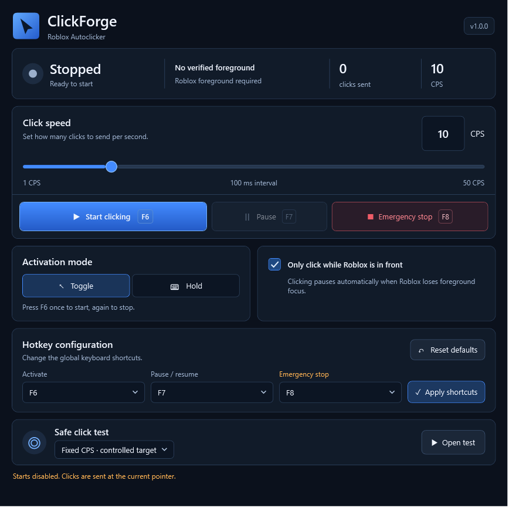

# ClickForge

A native, dark-mode Windows left-click utility built with C# and WPF. Includes fixed and variable CPS, global shortcuts, foreground restrictions, in-app updates and an isolated logical timing simulator.



## Download and run

Open the [latest public release](https://github.com/ojeshfrrr/ClickForge/releases/latest), download **ClickForge-v<version>-win-x64.zip**, and extract the entire ZIP. Close any older ClickForge instance, then open **ClickForge.exe**.

- **Windows x64** only; Windows 11 is recommended. Windows 10 support depends on the edition and lifecycle listed in the [.NET 10 supported OS matrix](https://github.com/dotnet/core/blob/main/release-notes/10.0/supported-os.md). Older Windows builds and other architectures are not release-tested.
- The portable, self-contained release includes .NET 10: a separate .NET installation is not required.
- No installer, administrator access, driver or background service is required.
- Clicking starts disabled every time. Settings never restore an active session.
- The executable is unsigned. No Microsoft signing or approval is claimed. Do not disable antivirus to run it.

Some Roblox experiences prohibit autoclickers. Using automated clicking may violate experience rules and carry account-enforcement risk. Check the rules before use. ClickForge is not Roblox-approved, undetectable or guaranteed to work in any particular experience.

## In-app updates (1.1.1 and later)

Open **Updates** in the header for the installed/latest version, release notes and a manual check. Optional startup checks default off. **Update now** downloads and verifies the stable Windows x64 package; **Install and restart** requires a separate confirmation. **Later** defers it. Download/check cancellation and friendly offline/rate-limit errors leave the app usable.

Keep `ClickForge.Updater.exe` beside `ClickForge.exe`. The independent helper waits for clean shutdown, backs up managed files, replaces/verifies the package, and requires a version-specific startup acknowledgement before success. Rollback preserves settings. Updates always restart with clicking disabled. No administrator access is requested.

The existing **v1.0.0 needs one manual bootstrap download**, because that executable did not contain update code. Only a newly published matching version tag produces an update; a main-branch push does not. See [the complete updating/recovery guide](docs/UPDATING.md) for exact version/tag commands, package contents, workflow behavior and verification limits. SHA-256 is integrity checking, not a digital publisher signature.

## Features and controls

- **Fixed speed:** 1–50 CPS, default 10; synchronized slider and validated numeric input. Live changes update the existing worker.
- **Variable speed:** 1–50 CPS limits, default 5–20; explicitly selected desktop windows, including verified Roblox clients.
- **Toggle:** press the activation key once to start, again to stop.
- **Hold:** click only while holding the activation key; key release or a foreground-window change ends activation.
- **Roblox-only restriction:** enabled by default. Input requires a nonminimized, verified Roblox foreground client. Unverifiable targets fail closed.
- **Emergency stop:** stops the live engine and any open safe test.
- **Shortcuts:** configurable, distinct function keys F1–F11; conflicts and registration failures are reported.
- **Settings:** validated JSON at `%LOCALAPPDATA%/ClickForge/settings.json`, written atomically; corrupt files recover to defaults.
- **Safe Click Test:** fixed input is restricted to a controlled target window. Variable timing produces logical events only.

| Default key | Action |
| --- | --- |
| F6 | Toggle activation, or hold activation in Hold mode |
| F7 | Pause/resume an active request |
| F8 | Emergency stop |

**Start clicking** and **Pause/Resume** also work from the interface. In Hold mode, the start control explains which key to hold. Editing configuration never starts clicking. Closing the app stops its worker and releases any outstanding simulated button state.

The count records input pairs sent by Windows, not proof that a game accepted them. Windows scheduling does not guarantee exact timing.

## Variable CPS for Roblox and desktop applications

Choose **Variable CPS** beside Click speed. Set minimum and maximum rates (whole numbers from 1 to 50, initially 5–20). Numeric inputs and sliders synchronize; crossing sliders moves the other endpoint to keep a valid range. Invalid typed limits stop input and must be corrected before activation. The dashboard shows the configured range, not a measured average.

Click **Refresh windows**, then explicitly select Roblox or another eligible desktop application. Starting with **1.1.2**, Roblox clients are included when they pass the same executable-name, publisher and Authenticode signature checks used by Fixed CPS. Unknown identities and unverified Roblox clients remain excluded. Selection is session-local and is never restored from an old process/window identifier. Start from ClickForge or the selected window. Input pauses unless the exact selected process/window is in front, nonminimized, alive, and under the pointer. Focus restoration can resume an active Toggle request; Hold additionally requires the original activation window and key to remain valid.

The fixed-mode Roblox-only preference remains stored and unchanged. Variable mode always applies its selected-window restriction regardless of that preference. Changing timing mode, range or selected target stops the request; explicitly activate again. The single existing worker, emergency stop, input error handling and shutdown cleanup serve both modes.

Each interval samples a rate uniformly between the configured limits, then uses `1000 / sampledCps` milliseconds. Equal limits give a constant interval. The first variable event waits one sampled interval; fixed mode retains its immediate first event. Scheduling delays can make measured intervals longer. For 5–20 CPS the theoretical long-run throughput is approximately 10.82 CPS, rather than the arithmetic midpoint. This is bounded random timing, with no human-mimicry model or guarantee of synthetic input acceptance.

Process metadata/title classification is a conservative desktop check, not an application identity attestation or a browser-content inspector. Applications with missing metadata may be unavailable. Foreground checks and Windows input delivery are separate OS operations, so an instantaneous focus change can race delivery. No process injection, memory modification, driver, or anti-cheat bypass is implemented.

## Variable Timing — Safe Test Only

In **Safe click test**, select **Variable Timing — Safe Test Only**, then **Open test**. Enter minimum and maximum whole-number rates from **5 to 20 CPS**, with minimum no greater than maximum. Optionally supply a signed 32-bit seed. Start runs a five-second logical simulation.

The simulator has no mouse-input service, live-engine reference or output callback. It sends no mouse or keyboard input. Live Toggle/Hold activation is blocked while Safe Click Test is open. Stop test, the configured emergency key, leaving the test window or closing it cancels the run.

The test window distinguishes configured rates from measured average CPS and logs requested/measured intervals. It shows the latest 60 events; summary statistics include all events. Average CPS is total logical events divided by measured elapsed time, including the initial wait and partial final wait.

Requested intervals are sampled uniformly between `1000 / maximum CPS` and `1000 / minimum CPS`. For 5–20 CPS this is 50–200 ms, with theoretical long-run throughput around 8 CPS rather than the midpoint of the rate range. A seed repeats requested intervals in the same application/runtime; actual timestamps and duration-boundary event counts can vary. This feature is for isolated timing tests, not detection evasion.

## Build from source

Install the **.NET 10 SDK** on Windows. `global.json` records the verified SDK version, 10.0.401. From the repository root in PowerShell:

```powershell
./build.ps1
```

The script restores dependencies, builds Release, runs core tests and safe UI diagnostics, and publishes a self-contained x64 app and independent helper to `artifacts/package`, plus a versioned ZIP/checksum. Official Microsoft runtime packs may be downloaded during the first publish. There are no third-party NuGet dependencies. Generated output and test configuration are ignored by Git.

Manual commands:

```powershell
dotnet restore src/ClickForge/ClickForge.csproj
dotnet build src/ClickForge/ClickForge.csproj -c Release -o artifacts/ui-build
dotnet run --project tests/ClickForge.Tests -c Release
dotnet run --project tests/ClickForge.UpdateTests -c Release
```

Safe UI diagnostics use their own settings and a mocked mouse:

```powershell
$report = Join-Path (Get-Location) 'artifacts/ui-tests.txt'
& ./artifacts/ui-build/ClickForge.exe --ui-self-test $report
```

The app writes its results and rendered images next to the report. Native hotkey reservation may be unavailable in a sandbox. Routed command checks do not prove physical global-key delivery. Neither test suite automates a live Roblox session.

For a render-only preview without hotkeys, saved preferences or activation:

```powershell
$preview = Join-Path (Get-Location) 'artifacts/preview.png'
& ./artifacts/ui-build/ClickForge.exe --render-preview $preview
```

Optional `--preview-size 640 700` checks the narrow layout.

## Architecture

- `ClickForge.Core`: fixed click scheduling/lifecycle, reusable interruptible timing, settings/hotkey validation and the independent logical simulator.
- `ClickForge`: WPF views, reusable theme dictionary, SendInput interop, foreground signature/publisher verification, global hotkeys and the controlled test window.
- `ClickForge.Tests`: dependency-free executable test harness covering timing, cancellation, cleanup, persistence, hotkey failures and simulator isolation.
- `UiDiagnostics.cs`: opt-in real-control tests with mocked input and runtime-rendered screenshots.

## Limitations and troubleshooting

- **Shortcut unavailable:** close another ClickForge instance or select different function keys, then Apply shortcuts. Clicking remains disabled until shortcuts register successfully.
- **Waiting for Roblox:** bring a supported Roblox client to the foreground. Roblox Studio and unverifiable clients remain blocked. Recognized executable names include RobloxPlayerBeta.exe, RobloxPlayer.exe and Windows10Universal.exe, with publisher and Windows signature checks.
- **Input rejected or ignored:** Windows integrity levels and applications may block synthetic input. ClickForge reports its own input state and does not bypass target restrictions.
- **Release launch:** extract the ZIP before opening the EXE. The single-file runtime extracts native components to the per-user temporary .NET bundle cache, so a writable temporary directory is required.
- **Timing:** measured intervals may exceed requested intervals due to scheduling delays. The live counter refreshes at most once a second while active; stop and input scheduling do not depend on that display interval.
- **Foreground changes:** window checking and SendInput are separate Windows operations, so they cannot guarantee an atomic target during a simultaneous focus switch.
- **Performance:** WPF working set and visible-window CPU depend on rendering and desktop activity. Short diagnostic samples are not a near-zero CPU guarantee.

The application does not inject code, alter Roblox memory or clients, install kernel components, or bypass anti-cheat protections.

## License

No source-code license has been selected yet. Public access to this repository is not a statement that a particular open-source license applies.

## Development reports

[UI change history](UI-CHANGES.md) and [Variable Timing implementation](VARIABLE-TIMING.md) describe the earlier implementation checks. Current release verification is recorded in the release notes; historical results are not a substitute for current tests.
