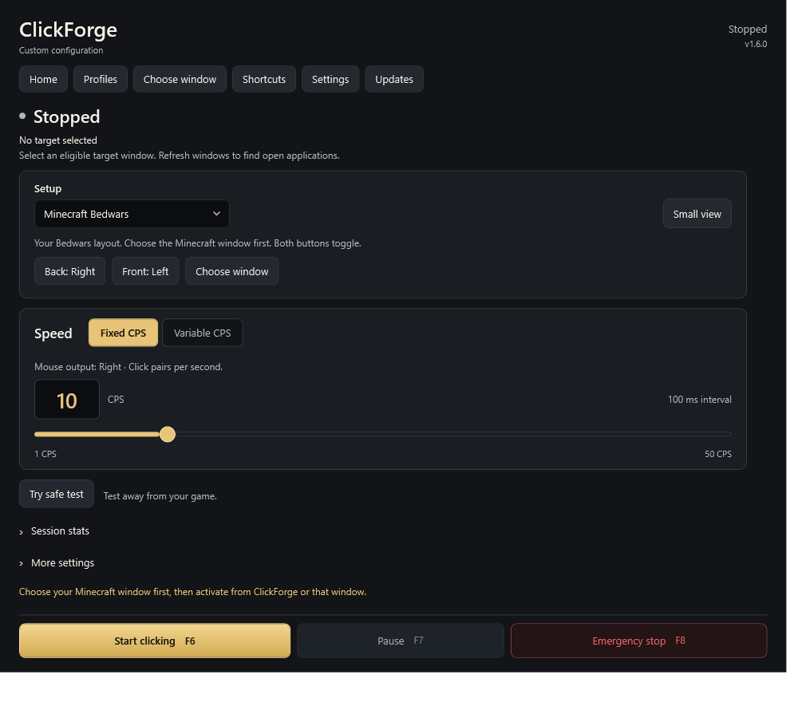

# ClickForge

A native Windows mouse-click and key-repeat utility built with C# and WPF.
**v1.6.1** introduces a simpler Home view, separate mouse setups and a clearer
updater. Choose Regular clicker, the original Mouse buttons layout, or
**Minecraft Bedwars**: **Front / Mouse 5 → Left**, **Back / Mouse 4 → Right**, both
Toggle, using an explicitly selected target window. Existing timing modes,
profiles, target checks, session limits, shortcuts and shutdown safeguards remain.
See the [release notes](docs/RELEASE-v1.6.1.md) and [setup guide](docs/BEDWARS-SETUP.md).

The dark-and-gold Home view keeps setup and speed visible, puts details behind
**Session stats** and **More settings**, and pins Start, Pause and Emergency Stop
outside scrolling content. **Choose window** opens the actual target inspector.
See the [earlier design history](docs/OBSIDIAN-REDESIGN.md).



The dashboard also shows current-session wall-clock elapsed time (including pauses and target waits), input pairs sent, and measured average CPS. Stop freezes these values; a new explicit activation resets them. Target explanations report the actual blocking check. These statistics remain in memory and do not imply the target accepted input. See [session statistics and target status](docs/SESSION-STATISTICS.md).

Dashboard refreshes now run once per second while idle and twice per second while active. Hidden/minimized windows skip dashboard rendering; tray state and global shortcuts remain available. Commands and restoring the window refresh immediately. The click worker and target restrictions are unchanged. This reduces UI work, not the bundled WPF runtime size; no major RAM reduction or zero-CPU guarantee is claimed. See [measurements and verification limits](docs/LIGHTWEIGHT.md).

Expand **More settings → Advanced session controls** for auto-stop limits,
application-profile suggestions, the private safety timeline, compact controls
and commands. **Ctrl+K** also opens commands. Safe Click Test includes a logical
timing scope. See [usage, privacy and verification](docs/ADVANCED-CONTROLS.md).

In **Regular clicker**, choose **Output → Mouse**, then **Left**, **Mouse 4 (Back)**,
**Mouse 5 (Forward)** or **Right**. Mouse → Left remains the default. Changing
output stops input; settings and profiles remember it. **Try safe test** inspects
down/up events in the controlled pad. Unsupported input stops with an error and
never falls back to Left. See [output selection](docs/OUTPUT-TYPES.md) and
[Right-click verification](docs/RIGHT-CLICK.md).

Choose **Input type → Keyboard** to capture one supported key, or reuse the last conflict-free captured key. **Key: … · Change** opens the recorder. This output is separate from global shortcuts; conflicting keys and modifier combinations are rejected. Cancelling preserves the previous output. See [custom-key transport behavior](docs/CUSTOM-INPUT-KEY.md) and [the output UI guide](docs/OUTPUT-TYPES.md).

Choose **Mouse buttons** for Back → Left / Front → Right, or **Minecraft Bedwars**
for Back → Right / Front → Left. The same side button stops; the other switches
the single worker. Setup selects Toggle and F6/F7/F8 while preserving speed and
regular target preferences. Bedwars requires a selected foreground window with
the pointer inside. **Small view** offers the same setups. No setup auto-starts.
See [current setup and verification](docs/BEDWARS-SETUP.md).

**Mouse 4 (Back)** and **Mouse 5 (Forward)** are also available in each **Global shortcuts** dropdown for Activate, Pause and Emergency stop. Select a shortcut and click **Apply shortcuts**. Mouse shortcuts work in Toggle and Hold mode; generated mouse clicks are ignored by the shortcut listener. For Hold, use a different click-output button from the mouse activation shortcut. F6/F7/F8 remain the defaults. See [mouse hotkeys and verification](docs/MOUSE-HOTKEYS.md).

## Download and run

Two distribution choices are available from the [latest release](https://github.com/ojeshfrrr/ClickForge/releases/latest): Windows Setup and a portable ZIP.

**Recommended: Windows installer**

1. Download **ClickForge-Setup-v<version>.exe** from a release that includes it.
2. Run Setup. It installs for your Windows account under `%LOCALAPPDATA%\Programs\ClickForge`, with no normal administrator requirement.
3. Keep **Create Desktop shortcut** and **Create Start menu shortcut** checked, or opt out of either.
4. Launch **ClickForge** from the Desktop or Start menu. Clicking always starts disabled.

**Portable ZIP**

1. Download **ClickForge-v<version>-win-x64.zip** from the [latest public release](https://github.com/ojeshfrrr/ClickForge/releases/latest).
2. Extract the entire ZIP into a stable folder you own.
3. Open **ClickForge.exe** there, keeping the helper alongside it.

The installer is easier for everyday use and keeps the application out of Downloads. Both distributions use the same self-contained payload and existing in-app updater. See [installation, uninstall and build details](docs/INSTALLING.md).

- **Windows x64** only; Windows 11 is recommended. Windows 10 support depends on the edition and lifecycle listed in the [.NET 10 supported OS matrix](https://github.com/dotnet/core/blob/main/release-notes/10.0/supported-os.md). Older Windows builds and other architectures are not release-tested.
- The portable, self-contained release includes .NET 10: a separate .NET installation is not required.
- No administrator access, driver, service or startup task is required. The portable option remains available without installation.
- Clicking starts disabled every time. Settings never restore an active session.
- The executable is unsigned. No Microsoft signing or approval is claimed. Do not disable antivirus to run it.

Some Roblox experiences prohibit autoclickers. Using automated clicking may violate experience rules and carry account-enforcement risk. Check the rules before use. ClickForge is not Roblox-approved, undetectable or guaranteed to work in any particular experience.

## In-app updates (1.1.1 and later)

Open **Updates** in the navigation rail for the installed/latest version, release notes and a manual check. Optional startup checks default off. **Update now** downloads and verifies the stable Windows x64 package; **Install and restart** requires a separate confirmation. **Later** defers it. Download/check cancellation and friendly offline/rate-limit errors leave the app usable.

Keep `ClickForge.Updater.exe` beside `ClickForge.exe`. The independent helper waits for clean shutdown, backs up managed files, replaces/verifies the package, and requires a version-specific startup acknowledgement before success. Rollback preserves settings. Updates always restart with clicking disabled. No administrator access is requested.

The existing **v1.0.0 needs one manual bootstrap download**, because that executable did not contain update code. Only a newly published matching version tag produces an update; a main-branch push does not. See [the complete updating/recovery guide](docs/UPDATING.md) for exact version/tag commands, package contents, workflow behavior and verification limits. SHA-256 is integrity checking, not a digital publisher signature.

## Profiles, tray and everyday use

Open **Profiles** in the navigation rail to create a named configuration from the current timing controls. Select a profile to review its summary, then **Apply profile**. Application stops the current request, leaves the selected target unchanged, and requires explicit activation. Profiles remember Fixed/Variable CPS, the fixed rate, minimum/maximum rates, Toggle/Hold activation, and the selected mouse/custom-key output. Shortcuts and target restrictions remain application preferences. The header identifies the applied profile and shows **modified** after timing edits.

The profile manager supports rename, description, saving current timing into an existing profile, duplicate, confirmed delete, import/export, and restoring the two built-in profiles. Import creates an independent copy and never applies it automatically. Deleting the active profile keeps the current timing configuration and stops input. Restoring application defaults keeps saved profile files.

Profiles use separate versioned JSON files in `%LOCALAPPDATA%/ClickForge/Profiles/<id>.json`; preferences remain in `settings.json`. A malformed profile is skipped while other valid profiles remain available. Writes use per-path locks, flushed temporary files and atomic replacement. Imports are limited to 16 KiB, 100 stored profiles, 80-character names and 500-character descriptions. Unknown fields, duplicate properties, invalid rates/enums, unsupported versions, scripts, target identities and safety overrides are rejected. See [the JSON format and implementation verification report](docs/V1.2.0.md).

ClickForge registers one real Windows notification-area icon. Its menu opens the existing window, routes Start/Stop and Pause/Resume through the normal controls, provides Emergency Stop, and opens Profiles, Updates and Settings. **Exit ClickForge** performs full cleanup. A second ordinary launch restores the existing instance. The tray tooltip reports actual engine state, including waiting for a target. Windows may place the icon in its overflow area.

**Minimize to tray** and **Close to tray** are separate, opt-in Settings preferences, both off by default. Hiding stops input; restoring never starts it. Hiding is available only while the tray icon exists and no owned dialog is open. If tray initialization fails, the app keeps ordinary window behavior. Windows session ending and updater restart use the coordinated exit path regardless of close-to-tray preferences.

Settings includes current version, Windows version, engine/timing state, shortcut status, update state and a bounded in-memory activity history. Copy or export a redacted report for troubleshooting; it omits profile names, target identities and local paths. History retains at most 100 meaningful events, never individual clicks, and can be cleared. It is not written to disk unless explicitly exported.

Controls expose accessible labels, visible keyboard focus, ordinary Tab/Shift+Tab navigation and polite state announcements. Profile dialogs support Escape without applying pending edits. Expand **Global shortcuts** to change key assignments; the main action row always shows the active shortcuts. There are no animated transitions, so reduced-motion settings need no animation suppression. Smaller windows scroll intentionally. Native display scaling and screen-reader verification limits are recorded in the implementation reports.

## Features and controls

- **Fixed speed:** 1–50 CPS, default 10; synchronized slider and validated numeric input. Live changes update the existing worker.
- **Variable speed:** 1–50 CPS limits, default 5–20; explicitly selected desktop windows, including verified Roblox clients.
- **Toggle:** press the activation key once to start, again to stop.
- **Hold:** click only while holding the activation key; key release or a foreground-window change ends activation.
- **Roblox-only restriction:** enabled by default. Input requires a nonminimized, verified Roblox foreground client. Unverifiable targets fail closed.
- **Emergency stop:** stops the live engine and any open safe test.
- **Shortcuts:** configurable, distinct function keys F1–F11; conflicts and registration failures are reported.
- **Settings:** validated JSON at `%LOCALAPPDATA%/ClickForge/settings.json`, written atomically; corrupt files recover to defaults.
- **Safe Click Test:** fixed input is restricted to a controlled target window. Variable timing produces logical events only.

| Default key | Action |
| --- | --- |
| F6 | Toggle activation, or hold activation in Hold mode |
| F7 | Pause/resume an active request |
| F8 | Emergency stop |

**Start clicking** and **Pause/Resume** also work from the interface. In Hold mode, the start control explains which key to hold. Editing configuration never starts clicking. Closing the app stops its worker and releases any outstanding simulated button state.

The count records input pairs sent by Windows, not proof that a game accepted them. Windows scheduling does not guarantee exact timing.

## Variable CPS for Roblox and desktop applications

Choose **Variable CPS** beside Click speed. Set minimum and maximum rates (whole numbers from 1 to 50, initially 5–20). Numeric inputs and sliders synchronize; crossing sliders moves the other endpoint to keep a valid range. Invalid typed limits stop input and must be corrected before activation. The dashboard shows the configured range, not a measured average.

Click **Refresh windows**, then explicitly select Roblox or another eligible desktop application. Starting with **1.1.2**, Roblox clients are included when they pass the same executable-name, publisher and Authenticode signature checks used by Fixed CPS. Unknown identities and unverified Roblox clients remain excluded. Selection is session-local and is never restored from an old process/window identifier. Start from ClickForge or the selected window. Input pauses unless the exact selected process/window is in front, nonminimized, alive, and under the pointer. Focus restoration can resume an active Toggle request; Hold additionally requires the original activation window and key to remain valid.

The fixed-mode Roblox-only preference remains stored and unchanged. Variable mode always applies its selected-window restriction regardless of that preference. Changing timing mode, range or selected target stops the request; explicitly activate again. The single existing worker, emergency stop, input error handling and shutdown cleanup serve both modes.

Each interval samples a rate uniformly between the configured limits, then uses `1000 / sampledCps` milliseconds. Equal limits give a constant interval. The first variable event waits one sampled interval; fixed mode retains its immediate first event. Scheduling delays can make measured intervals longer. For 5–20 CPS the theoretical long-run throughput is approximately 10.82 CPS, rather than the arithmetic midpoint. This is bounded random timing, with no human-mimicry model or guarantee of synthetic input acceptance.

Process metadata/title classification is a conservative desktop check, not an application identity attestation or a browser-content inspector. Applications with missing metadata may be unavailable. Foreground checks and Windows input delivery are separate OS operations, so an instantaneous focus change can race delivery. No process injection, memory modification, driver, or anti-cheat bypass is implemented.

## Variable Timing — Safe Test Only

In **Safe click test**, select **Variable Timing — Safe Test Only**, then **Open test**. Enter minimum and maximum whole-number rates from **5 to 20 CPS**, with minimum no greater than maximum. Optionally supply a signed 32-bit seed. Start runs a five-second logical simulation.

The simulator has no mouse-input service, live-engine reference or output callback. It sends no mouse or keyboard input. Live Toggle/Hold activation is blocked while Safe Click Test is open. Stop test, the configured emergency key, leaving the test window or closing it cancels the run.

The test window distinguishes configured rates from measured average CPS and logs requested/measured intervals. It shows the latest 60 events; summary statistics include all events. Average CPS is total logical events divided by measured elapsed time, including the initial wait and partial final wait.

Requested intervals are sampled uniformly between `1000 / maximum CPS` and `1000 / minimum CPS`. For 5–20 CPS this is 50–200 ms, with theoretical long-run throughput around 8 CPS rather than the midpoint of the rate range. A seed repeats requested intervals in the same application/runtime; actual timestamps and duration-boundary event counts can vary. This feature is for isolated timing tests, not detection evasion.

## Build from source

Install the **.NET 10 SDK** on Windows. `global.json` records the verified SDK version, 10.0.401. From the repository root in PowerShell:

```powershell
./build.ps1
```

The script restores dependencies, builds Release, runs core tests and safe UI diagnostics, and publishes a self-contained x64 app and independent helper to `artifacts/package`, plus a versioned ZIP/checksum. Official Microsoft runtime packs may be downloaded during the first publish. There are no third-party NuGet dependencies. Generated output and test configuration are ignored by Git.

Manual commands:

```powershell
dotnet restore src/ClickForge/ClickForge.csproj
dotnet build src/ClickForge/ClickForge.csproj -c Release -o artifacts/ui-build
dotnet run --project tests/ClickForge.Tests -c Release
dotnet run --project tests/ClickForge.UpdateTests -c Release
```

Safe UI diagnostics use their own settings and a mocked mouse:

```powershell
$report = Join-Path (Get-Location) 'artifacts/ui-tests.txt'
& ./artifacts/ui-build/ClickForge.exe --ui-self-test $report
```

The app writes its results and rendered images next to the report. Native hotkey reservation may be unavailable in a sandbox. Routed command checks do not prove physical global-key delivery. Neither test suite automates a live Roblox session.

For a render-only preview without hotkeys, saved preferences or activation:

```powershell
$preview = Join-Path (Get-Location) 'artifacts/preview.png'
& ./artifacts/ui-build/ClickForge.exe --render-preview $preview
```

Optional `--preview-size 640 700` checks the narrow layout.

## Architecture

- `ClickForge.Core`: fixed click scheduling/lifecycle, reusable interruptible timing, settings/hotkey validation and the independent logical simulator.
- `Profiles.cs`, `UserData.cs`, `ActivityHistory.cs`: strict portable profile schema/storage, shared atomic writes and bounded redacted events.
- `ClickForge`: WPF views, reusable theme dictionary, SendInput interop, foreground signature/publisher verification, global hotkeys and the controlled test window.
- `TrayService.cs`, `SingleInstance.cs`: native Shell notification-area integration and a per-user, per-session mutex/open signal. No additional UI framework or tray dependency.
- `ClickForge.Tests`: dependency-free executable test harness covering timing, cancellation, cleanup, persistence, hotkey failures and simulator isolation.
- `UiDiagnostics.cs`: opt-in real-control tests with mocked input and runtime-rendered screenshots.

## Limitations and troubleshooting

- **Shortcut unavailable:** close another ClickForge instance or select different function keys, then Apply shortcuts. Clicking remains disabled until shortcuts register successfully.
- **Waiting for Roblox:** bring a supported Roblox client to the foreground. Roblox Studio and unverifiable clients remain blocked. Recognized executable names include RobloxPlayerBeta.exe, RobloxPlayer.exe and Windows10Universal.exe, with publisher and Windows signature checks.
- **Input rejected or ignored:** Windows integrity levels and applications may block synthetic input. ClickForge reports its own input state and does not bypass target restrictions.
- **Release launch:** extract the ZIP before opening the EXE. The single-file runtime extracts native components to the per-user temporary .NET bundle cache, so a writable temporary directory is required.
- **Timing:** measured intervals may exceed requested intervals due to scheduling delays. The live counter refreshes at most once a second while active; stop and input scheduling do not depend on that display interval.
- **Foreground changes:** window checking and SendInput are separate Windows operations, so they cannot guarantee an atomic target during a simultaneous focus switch.
- **Performance:** WPF working set and visible-window CPU depend on rendering and desktop activity. Short diagnostic samples are not a near-zero CPU guarantee.

The application does not inject code, alter Roblox memory or clients, install kernel components, or bypass anti-cheat protections.

## License

No source-code license has been selected yet. Public access to this repository is not a statement that a particular open-source license applies.

## Development reports

[UI change history](UI-CHANGES.md) and [Variable Timing implementation](VARIABLE-TIMING.md) describe the earlier implementation checks. Current release verification is recorded in the release notes; historical results are not a substitute for current tests.
