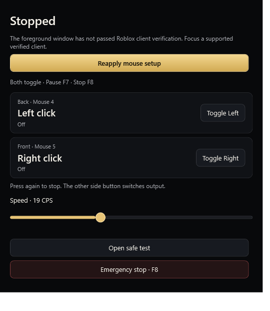

# Simple mouse controls and side-button assignments

Open **Hotkeys → Mouse controls → Apply mouse setup**.

| Physical button | Output | Action |
| --- | --- | --- |
| Mouse 4 (Back) | Left click | Toggle on/off |
| Mouse 5 (Forward) | Right click | Toggle on/off |

The same side button stops its request, including a manually paused request.
The other switches outputs after the existing synchronous stop/release barrier.
There is one existing worker, not two simultaneous input loops. Physical
side-button events are observed without being consumed; they may also reach the
foreground application. Injected side-button events and repeated downs do not
trigger these shortcuts.

**Apply mouse setup** explicitly enables assignments, selects Toggle mode, Left
output and F6/F7/F8 shortcuts. It retains CPS, timing mode, target restrictions,
session limits and profiles. Setup, window open/close and speed changes stop input;
none starts it. Assignments are a global settings preference, default off, and
cannot conflict with the normal Activate/Pause/Emergency shortcuts. Hold mode
leaves these side-toggle actions inactive and explains why.

The simple window shows actual Off, Sending, Paused, Waiting for target or Error
state for each output. It never equates an enabled request with target acceptance.
The Fixed CPS slider changes the existing engine/dashboard. Variable mode shows
the configured range and keeps its existing dashboard controls. The default
540×620 window fits essential controls without scrolling at the tested display
scale; smaller windows scroll while Safe Test and Emergency Stop remain pinned.
The existing refresh timer updates the window with cached display values; no
per-input UI dispatch, polling thread or new dependency was added.

Safe Test uses the existing isolated controlled pad/logical simulator. Opening it
stops live input; side assignments cannot activate the production worker while
the test is open. All existing target gates, pause, error, emergency and shutdown
release paths remain in place. Selecting another target or profile never starts
input. Settings never persist active requests.

## Verification — 27 October 2026

Executed `./build.ps1 -SkipPackage -BuildDirectory artifacts/simple-mouse-delivery`:

- Release app/helper builds: zero warnings and errors.
- **177 core tests, 36 updater tests and 258 WPF checks passed: 471 total.**
- Side-button mapping, injected/repeated event rejection, shortcut reservation
  conflicts/rollback, defaults, settings migration and profile preservation.
- Actual WPF setup, output switching, same-button stop, manual pause, emergency,
  target blocking, Hold-mode explanation, safe-test isolation and disabling.
- Simple-window lifecycle, actual state labels, synchronized speed, Variable
  slider visibility, default-size fit and smaller-window pinned emergency control.
- Existing keyboard capture, Left/Right/X-button transport mapping, partial-pair
  release, target validation, profiles, updater and shutdown regressions.
- Runtime-rendered default/small screenshots were inspected. Final default
  screenshot: `artifacts/logs/ui-simple-mouse-controls.png`.
- Logs: `artifacts/logs/simple-mouse-delivery-build.txt` and
  `artifacts/logs/simple-mouse-delivery-ui.txt`. Final diff whitespace check passed.

A first UI run exposed stale disposable test output from the previous suite.
Automated self-tests now start with default disposable settings; interactive and
normal launches still load saved settings. A dropdown diagnostic now waits for
scroll/focus settling before opening its popup. The first simple-window screenshot
also exposed default scrolling; denser rows and a revised default height fixed
that layout, and the final no-scroll assertion was executed successfully.

Production input was mocked. Routed safe-pad events and native hook registration
do not prove physical side-button delivery or target acceptance. No automated
input was sent into Roblox. Screenshot-heavy diagnostic CPU remains high/variable
and is not characterized as fixed. Installer/package tests run separately in the
tagged release workflow; see the release's final job logs for their results.

## Files for side assignments and simple controls

- `src/ClickForge.Core/SideButtonOutputs.cs`
- `src/ClickForge.Core/Settings.cs`
- `src/ClickForge/MainWindow.SideButtons.cs`
- `src/ClickForge/SideButtonControlWindow.cs`
- `src/ClickForge/MainWindow.xaml`
- `src/ClickForge/MainWindow.xaml.cs`
- `src/ClickForge/MainWindow.Advanced.cs`
- `src/ClickForge/UiDiagnostics.cs`
- `src/ClickForge/UiDiagnostics.SideButtons.cs`
- `src/ClickForge/UiDiagnostics.SimpleMouse.cs`
- `tests/ClickForge.Tests/SideButtonOutputTests.cs`
- `tests/ClickForge.Tests/Program.cs`
- `README.md`, `scripts/Package-Release.ps1`, this guide and v1.5 release notes.

Separate selector and Right-output file lists/history are in
[OUTPUT-TYPES.md](OUTPUT-TYPES.md) and [RIGHT-CLICK.md](RIGHT-CLICK.md).

The tested local application/helper files were hash-checked into `artifacts/ui-build`.
Previous files and settings were backed up under
`artifacts/backups/before-simple-mouse-20261027-173238`.
